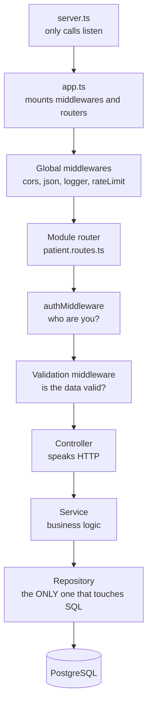
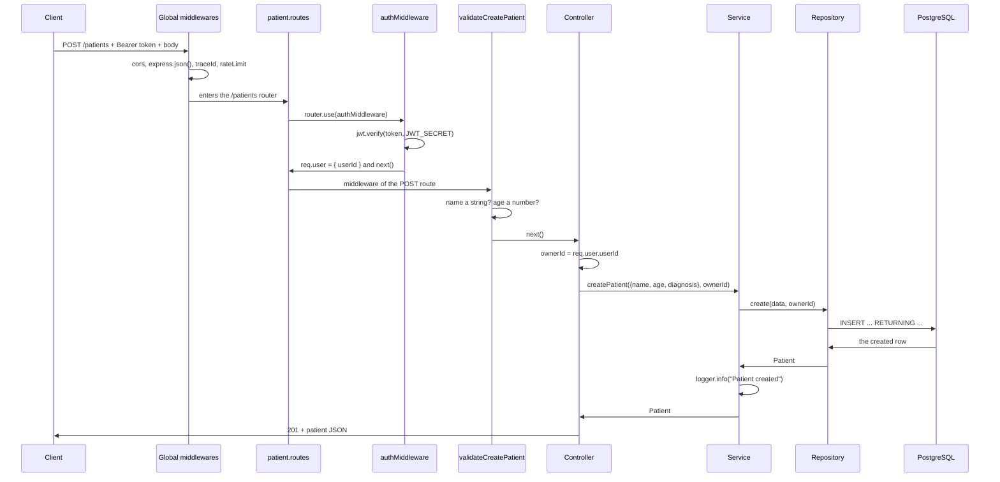
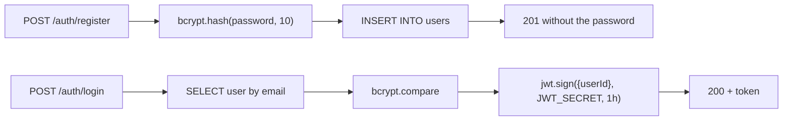

# Project architecture

> How the API is built on the inside: which layers there are, what each one
> does, what it is forbidden to do, and how a request travels from the moment
> it comes in until it goes out. Written to be **defended**, not just looked
> up.

---

## 1. First things first: this is NOT hexagonal architecture

It is worth making this clear from the start, because it is exactly the kind
of thing you may be asked about in a code review or an interview.

What you have is a **layered architecture**, with an `infra/` folder that
nods to the hexagonal idea. They are not the same:

|                                              | Layered architecture (this project)                                                                        | Hexagonal (ports and adapters)                                                                        |
| -------------------------------------------- | ---------------------------------------------------------------------------------------------------------- | ----------------------------------------------------------------------------------------------------- |
| How the service calls the repository         | `import * as patientData from "./infra/repositories/patient.repository"` — imports **the concrete module** | The service depends on an **interface** (`PatientRepository`), and someone injects the implementation |
| If tomorrow you swap Postgres for MongoDB    | you touch the service, because it points straight at the file                                              | you do not touch the service: you write another adapter that fulfils the same interface               |
| Can the service be tested without a database | only by replacing the whole module with `jest.mock` (which is what the unit tests do)                      | yes, you pass it a fake repository                                                                    |

**Is this approach wrong?** No. For an API of this size, hexagonal would be
over-engineering: you would add interfaces and a dependency injection layer to
solve a problem (switching databases) that you do not have. Layered is a
legitimate decision and it is what most Express APIs of this size look like.

**What you cannot do is call it hexagonal.** If you are asked, the good
answer is: _"it is a layered architecture with a strict separation of
responsibilities; the `infra/` folder isolates data access, but there is no
dependency inversion, so it is not hexagonal in the proper sense"_.

---

## 2. The layer diagram



The golden rule: **each layer only talks to the one right below it.** A
controller never calls `pool.query`. A repository never knows what an HTTP
status code is.

### What each layer does and what it is FORBIDDEN to do

| Layer           | Example file            | Its job                                        | What it is forbidden to do                     |
| --------------- | ----------------------- | ---------------------------------------------- | ---------------------------------------------- |
| **Startup**     | `server.ts`             | open the port                                  | anything else (it is 8 lines)                  |
| **Application** | `app.ts`                | mount middlewares and routers, export `app`    | open the port — that is why the tests work     |
| **Middlewares** | `auth.middleware.ts`    | check before working; `next()` or cut it short | business logic                                 |
| **Routes**      | `patient.routes.ts`     | map URL + method → controller                  | contain logic                                  |
| **Controller**  | `patient.controller.ts` | read `req`, decide the status code, respond    | SQL, and knowing how a patient is stored       |
| **Service**     | `patient.service.ts`    | business rules, business logs                  | touching `req`/`res`, knowing HTTP exists      |
| **Repository**  | `patient.repository.ts` | **the only one that runs SQL**                 | deciding status codes or business rules        |
| **Types**       | `patient.types.ts`      | describe the shape of the data                 | nothing, it does not run (emits no JavaScript) |

---

## 3. The types layer: who uses it and why

`types/patient.types.ts` does nothing at runtime — TypeScript erases types
when compiling. Their value is that **they are the contract between layers**:

```ts
export interface Patient {
  // what COMES OUT of the database
  id: number;
  name: string;
  age: number;
  diagnosis?: string;
  owner_id: number; // snake_case: comes straight from the SQL
}

export interface CreatePatientInput {
  // what GOES IN to create one
  name: string;
  age: number;
  diagnosis?: string;
} // note: no id and no owner_id
```

Three different types for the same concept, and that is deliberate:

- `Patient` — what already exists in the database. It has an `id` because the
  database generated it.
- `CreatePatientInput` — what the client sends to create one. It does **not**
  have an `id` (it does not exist yet) or an `owner_id` (the server sets it
  from the token, not the client: if it came from the body, anyone could
  create patients on behalf of another practitioner).
- `UpdatePatientInput` — every field optional, because a `PATCH` is a partial
  update.

They are used by the **service** and the **repository**. The controller works
with what it takes from `req.body`, which arrives untyped.

> **The naming boundary is in the repository.** Inside the SQL string it is
> `owner_id` (column name, snake_case). Outside, in TypeScript variables, it
> is `ownerId` (camelCase). The repository is the translator between the two
> worlds.

---

## 4. Full journey of an authenticated request

This is the `POST /patients` case with a valid token and valid data:



### The order of the global middlewares, and why it matters

In `app.ts`, this is the actual order:

1. `corsMiddleware` — CORS headers.
2. `express.json()` — turns the text body into an object. **If this came
   after the routes, `req.body` would be `undefined` everywhere.**
3. `/docs` — Swagger UI.
4. `requestLogger` — generates the `traceId`, puts it in the `X-Trace-Id`
   header and starts the `AsyncLocalStorage`.
5. `generalLimiter` — limit of 100 requests per 15 min.
6. The routes.
7. `errorHandle` — last, because an error handler is only reached if
   something blows up before it.

### Where authorization lives, and why in two places

- **Authentication** (_who are you?_) → `authMiddleware`, mounted with
  `router.use()` on the whole router. It protects **every** route of the
  module at once. That is why a single 401 test per router covers all its
  routes.
- **Authorization** (_can you touch THIS patient?_) → inside each controller,
  comparing `patient.owner_id !== ownerId`. It cannot live in a generic
  middleware because it needs to **query the database** to know who that
  specific patient belongs to.

The order of checks inside the controller is always the same, and it is
deliberate:

```
401 (no token)  →  400 (the id is not a number)  →  404 (does not exist)  →  403 (exists but is not yours)
```

> Note the order, 404 before 403: first you check that it exists, then whether
> it is yours. The other way round would not work, because you could not know
> who owns something that does not exist.

---

## 5. The whole CRUD, route by route

| Method   | Route           | Route middlewares              | What the repository does            | Response              |
| -------- | --------------- | ------------------------------ | ----------------------------------- | --------------------- |
| `GET`    | `/patients`     | auth                           | `SELECT ... WHERE owner_id = $1`    | 200 + array           |
| `GET`    | `/patients/:id` | auth                           | `SELECT ... WHERE id = $1`          | 200 / 400 / 404 / 403 |
| `POST`   | `/patients`     | auth + `validateCreatePatient` | `INSERT ... RETURNING`              | 201 + the patient     |
| `PATCH`  | `/patients/:id` | auth + `validateUpdatePatient` | `UPDATE ... COALESCE ... RETURNING` | 200 / 400 / 404 / 403 |
| `DELETE` | `/patients/:id` | auth                           | `DELETE WHERE id = $1`              | 204 with no body      |

### Two repository details you need to be able to explain

**1. The list is filtered in SQL, not in JavaScript.**

```sql
SELECT * FROM patients WHERE owner_id = $1 ORDER BY id
```

You do not fetch every patient and then filter with `.filter()`. You fetch
only yours. With 10 rows it makes no difference; with 100,000 it is the
difference between an API that responds and one that falls over.

**2. The partial `PATCH` is solved with `COALESCE`.**

```sql
UPDATE patients
   SET name = COALESCE($2, name),
       age = COALESCE($3, age),
       diagnosis = COALESCE($4, diagnosis)
 WHERE id = $1
```

`COALESCE(a, b)` returns `a` if it is not `NULL`, and if it is, returns `b`.
Since the repository sends `data.name ?? null`, a field that is missing
arrives as `NULL` and the column **keeps the value it already had**. A single
`UPDATE` works for any combination of fields.

> **Watch out, this affects you right now:** the `RETURNING` of `update`
> returns `id, name, age, diagnosis` — **without `owner_id`**, unlike
> `create`, which does return it. So the response of a successful `PATCH`
> does not include `owner_id`. If you write a test that checks `owner_id` in
> the PATCH response, it will fail, and not because of the test.

---

## 6. The authentication flow, separately

`/auth` is the only module without `authMiddleware` — it would be absurd to
require a token to ask for a token.



Two security decisions live in there:

- **The password never leaves.** The repository returns the full `User` with
  `password_hash`, but the service builds a `UserView` (`id`, `email`,
  `name`) and that is what reaches the controller. The `UserView` type
  **exists precisely to make it impossible** to leak the hash by accident.
- **The same error for an unknown email and a wrong password.** Both cases
  return `401 "Invalid credentials"`. If you said "that email does not
  exist", you would be confirming which emails are registered at a clinic.

Both routes use `authLimiter` (5 attempts per 15 min, and only failed ones
count thanks to `skipSuccessfulRequests`), which is stricter than the
`generalLimiter` of the rest of the API.

---

## 7. The cross-cutting pieces

| Piece                    | File                        | What it solves                                                                                                                      |
| ------------------------ | --------------------------- | ----------------------------------------------------------------------------------------------------------------------------------- |
| **Connection pool**      | `database/pool.ts`          | The single place that decides which database to talk to, via `DATABASE_URL`. Switching databases **never** needs code changes       |
| **Configuration**        | `common/config/env.ts`      | Loads `.env` or `.env.test` depending on `NODE_ENV`, and **validates on startup**: if a variable is missing, the app does not start |
| **Trace ID**             | `common/context.ts`         | `AsyncLocalStorage` carries a unique id per request, so a whole request can be followed across the logs                             |
| **Logger**               | `common/logger.ts`          | Pino. `debug` level in development, `info` in production                                                                            |
| **Typing of `req.user`** | `common/types/express.d.ts` | `declare global` + _declaration merging_ to add `user` to Express's `Request`                                                       |

---

## 8. Known architecture debt

These are not oversights: they have been identified and can be defended as
such.

1. **`errorHandle` is mounted but never reached.** Every controller has its
   own `try/catch` that responds 500, so the error never reaches the global
   handler. The right thing would be to remove the repeated `catch` blocks
   and let the error bubble up — but that requires calling `next(error)`
   everywhere, and it is a pending refactor.
2. **The service imports the concrete repository** (the point from section 1:
   there is no dependency inversion). Practical consequence: the service can
   only be unit-tested without a real database by replacing the repository
   module with `jest.mock`, not by passing it a fake.
3. **`patient.service.ts` uses `owner_Id`** (with a capital I) in
   `listPatients`. Neither snake_case nor camelCase: a leftover from a
   half-finished rename.
4. **`X-Powered-By` is still enabled** — `app.disable("x-powered-by")` is
   missing.
5. **`/docs` is public in production.** A conscious decision for a portfolio
   project; in a real healthcare API it would sit behind authentication.

---

## 9. Questions you may be asked, and the short answer

**Why do you separate `app.ts` from `server.ts`?**
Because importing `app.ts` does not open any port. That is what lets
supertest send requests to the in-memory application during the tests,
without starting a real server.

**Why is the repository the only one that touches SQL?**
To have a single place to look when something database-related fails, and so
that changing a query does not force you to touch business logic. It is also
what makes it possible (in the future) to switch database engines by touching
a single layer.

**Why does `owner_id` not come in the body?**
Because the client cannot be trusted. It comes from the token, which is
signed with a secret only the server knows. If it came from the body, anyone
could create patients on behalf of another practitioner.

**Why 403 and not 404 when the patient belongs to someone else?**
It is a debatable decision and you need to know that: returning 403 confirms
that the patient exists. Some APIs return 404 on purpose so as not to leak
even that. Here 403 was chosen for clarity, assuming that the existence of an
id is not sensitive information in this context.

**What happens if the database goes down?**
`pool.query` throws, the controller's `catch` captures it, it is logged with
`logger.error` and the client gets a generic 500 — with no internal details,
which is correct: the details go to the log, not to the client.
